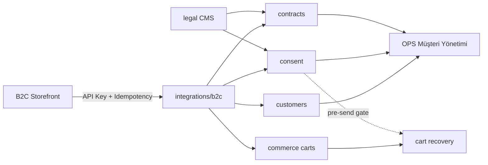

# Customer 360 & Consent Management — Mimari Analiz ve Uygulama Planı

**Durum:** Faz A uygulaması devam ediyor / onaylandı  
**Kapsam:** B2C → OPS müşteri, sepet, KVKK/izin, sözleşme kayıtları  
**Sonraki faz (ayrı):** WhatsApp / SMS (Faz 2 recovery) · Cart 360 = Faz B

---

## 1. Mevcut mimari özeti (yeniden kullanım)

### 1.1 Var olan ve yeniden kullanılacaklar

| Alan | Mevcut | Yol |
|------|--------|-----|
| Bireysel müşteri | `Customer` + `CustomerAddress` | `apps/backend/apps/customers/models.py` |
| Auth kullanıcı | `User` (email, phone, email_verified_at) | `apps/accounts` |
| B2B firma | `Organization` / Branch / Membership | `apps/organizations` |
| B2C sepet satırı | `B2cCartItem` (user FK) | `apps/commerce` |
| B2C sipariş | `B2cOrder` + adres snapshot | `apps/commerce` |
| Terk sepet | `CartRecoverySession` / `Attempt` / `OpsSalesTask` | `apps/commerce/recovery.py` |
| RBAC | `customers:manage`, `orders:manage`, `audit:read`, … | `apps/authorization/constants.py` |
| Audit | `record_audit(...)` | `apps/audit` |
| Idempotency | `IdempotentCreateMixin` | `apps/idempotency` |
| API key scopes | storefront / b2b / ops | `apps/api_keys` |
| Outbound webhooks | order events | `apps/webhooks` |
| Mail | `emit_mail_event` + şablonlar | `apps/mail` |
| Celery beat | stone lock, price lock, abandoned carts, retention | `config/settings.py` |
| OPS müşteri UI | `OpsCustomersPage` (temel CRUD) | `apps/frontend/ops` |
| Legal UI (statik) | Footer modal metinleri | `StorefrontLayout.tsx` |

### 1.2 Yok / yetersiz (yeni domain gerekir)

- **ConsentLog** (append-only izin kaydı, versiyon/hash/IYS ref)
- **LegalDocument** CMS (KVKK, mesafeli satış, ön bilgilendirme, üyelik, çerez…)
- **ContractAcceptance** (sipariş anında, immutable)
- **Cart header** + **CartEvent** (external cart ID, checkout state, event stream)
- **IntegrationEvent / inbound inbox** (B2C→OPS event ingest)
- Channel-scoped marketing consent gate before recovery send
- OPS menü: “Müşteri Yönetimi” + CMS yasal şablonlar
- ADR klasörü yok (`docs/` PDF ağırlıklı)

### 1.3 Kritik mimari gerilimler

1. **Sepet modeli:** Bugün `B2cCartItem` satır bazlı; entegrasyon “Cart + CartItem + Events” istiyor → yeni `CommerceCart` (veya `B2cCart`) header + satırlar; mevcut item’lar migrate/link edilir.
2. **Legal metinler:** Statik React string → versioned CMS `LegalDocument` + checkout’ta hash bağlama.
3. **Consent ≠ Contract:** Ayrı bounded context’ler (ileride B2B sözleşme/izin aynı çekirdeği kullanır).
4. **Recovery vs Consent:** Mevcut abandoned-cart e-postası izin kontrolü yapmıyor → gönderim öncesi `ConsentLog` zorunlu hale getirilecek.
5. **Guest:** Guest recovery email var; Customer eşleştirme + consent ayrı ele alınmalı.
6. **Customer kimlik parçalanması (yüksek öncelik):** `submit_b2c_order` her siparişte yeni `Customer` oluşturuyor; register’daki profil siparişlere bağlanmıyor. `Customer.user` unique değil (0..n). Faz A’da **get-or-update tek aktif Customer/User** zorunlu.
7. **Storefront adres API boşluğu:** Model + OPS CRUD var; UI `GET/POST/DELETE /api/v1/storefront/addresses` bekliyor (`B2cAccountPages` BackendPendingNotice). Faz A’da storefront address/profile API açılmalı.
8. **Zayıf sözleşme bayrakları:** `B2cOrder.accepted_custom_policy` / B2B `accepted_weight_tolerance` boolean ve default `True` — document version/hash yok; ContractAcceptance ile değiştirilecek.

---

## 2. Hedef domain ayrımı



**Bağımsız domain’ler (öneri):**
- `apps.consent` — ConsentLog, channel permissions, IYS refs
- `apps.contracts` — LegalDocument + ContractAcceptance
- `apps.customers` — genişletme (external_id, segment, contacts)
- `apps.commerce` — Cart header/events + recovery bağlama
- `apps.integrations` (veya `commerce` altında) — inbound IntegrationEvent inbox

---

## 3. Veri modeli önerisi

### 3.1 customers (genişlet)

**Customer** ek alanlar:
- `external_id` (unique, nullable) — B2C kaynak ID
- `segment` (`B2C` | `B2B` | `GUEST`)
- `email_verified` / bağ `user.email_verified_at`
- `marketing_blocked_until` (opsiyonel)

**CustomerContact** (yeni, opsiyonel — phone/email history):
- customer FK, kind, value, is_primary, verified_at

**CustomerAddress** — mevcut; billing/shipping type yeterli.

### 3.2 consent (yeni app)

**ConsentPurpose** (kod tablosu): `KVKK_NOTICE`, `EXPLICIT_CONSENT`, `COMMERCIAL_EMAIL`, `COMMERCIAL_SMS`, `COMMERCIAL_WHATSAPP`, `COMMERCIAL_CALL`

**ConsentLog** (append-only, soft-delete yok):
- customer FK (nullable guest_email)
- purpose, channel (`EMAIL`|`SMS`|`WHATSAPP`|`CALL`|`WEB`)
- status (`GRANTED`|`WITHDRAWN`|`DENIED`)
- source (`CHECKOUT`|`REGISTER`|`FOOTER`|`IYS`|`OPS`|`IMPORT`)
- granted_at / withdrawn_at
- document_version, document_hash, document_fk → LegalDocument
- iys_reference
- ip_hash (ham IP saklama; KVKK minimizasyon — hash + kısa TTL raw log ayrı)
- user_agent_hash
- correlation_id

Unique: yok (geçmiş korunur). Index: `(customer, purpose, channel, -created_at)`  
**Aktif izin:** son GRANTED ve sonrasında WITHDRAWN yok.

### 3.3 contracts (yeni app)

**LegalDocument**:
- code (`KVKK`, `DISTANCE_SALES`, `PRE_INFO`, `MEMBERSHIP`, `PRIVACY`, `COOKIE`, …)
- version (semver/string)
- title, body_html / body_md
- content_hash (sha256)
- effective_from, is_published
- audience (`B2C`|`B2B`|`ALL`)

**ContractAcceptance** (immutable):
- customer FK
- order FK (`B2cOrder`) — **zorunlu** (sepet kabul sayılmaz)
- document FK + version + content_hash snapshot
- accepted_at, source (`CHECKOUT`)
- evidence JSON (checkbox ids, locale)
- Unique `(order, document_code)` 

### 3.4 commerce cart (genişlet)

**B2cCart** (header):
- external_id unique
- user / customer FK
- status (`ACTIVE`|`ABANDONED`|`CONVERTED`|`EXPIRED`)
- currency, totals snapshot
- checkout_state
- last_activity_at
- converted_order FK nullable

**B2cCartItem** → cart FK ekle (geriye uyum: user+cart)

**CartEvent** append-only:
- cart FK, type enum, payload JSON, occurred_at, source, idempotency_key unique

**AbandonedCartTask** — mevcut `CartRecoverySession` ile birleştirilir veya üzerine `consent_checked_at` / `suppressed_for_consent` eklenir (yeniden yazılmaz).

### 3.5 integrations

**IntegrationEvent** (inbox):
- event_id unique
- source_system (`B2C_STOREFRONT`|…)
- event_type, schema_version
- occurred_at, received_at
- correlation_id, idempotency_key unique
- payload JSON
- status (`RECEIVED`|`PROCESSED`|`FAILED`|`DUPLICATE`)
- error_message

---

## 4. API sözleşmesi

### 4.1 Inbound (B2C → OPS) — API Key + Idempotency-Key header

```
POST /api/v1/integrations/b2c/events/
```
Tek entry (tercih edilen): `event_type` + payload. Alternatif kaynak-özel shortcut’lar:

```
POST /api/v1/integrations/b2c/customers/
POST /api/v1/integrations/b2c/carts/
POST /api/v1/integrations/b2c/consents/
POST /api/v1/integrations/b2c/contracts/
```

Hepsi aynı inbox + processor’a düşer.  
Auth: API key scope `integrations:b2c:write` (yeni).  
Idempotency: header → IntegrationEvent unique.  
Rate limit: mevcut throttle / Redis.

### 4.2 OPS UI API (session + RBAC)

```
GET/PATCH /api/v1/ops/customers/…
GET /api/v1/ops/customers/{id}/carts
GET /api/v1/ops/customers/{id}/consents
GET /api/v1/ops/customers/{id}/contracts
GET /api/v1/ops/customers/{id}/audit
GET /api/v1/ops/carts?status=&from=&to=
GET/POST /api/v1/ops/legal-documents
GET /api/v1/ops/customer-360/dashboard
```

### 4.3 Storefront (mevcut genişletme)

- Register / checkout: consent grant events
- Checkout submit: ContractAcceptance create (order sonrası)
- Recovery send: consent gate

---

## 5. Frontend menü (OPS)

**Ana menü — Müşteri İlişkileri / Müşteri Yönetimi** (CMS altında değil):

- Müşteri Listesi → genişletilmiş `OpsCustomersPage` / Customer 360
- Sepet Takibi → yeni
- İzin ve Onay Yönetimi → yeni
- Müşteri İşlem Geçmişi → audit + events

**CMS / Kurumsal & Yasal:**

- KVKK ve Aydınlatma Metinleri
- Sözleşme Şablonları (mesafeli, ön bilgilendirme, üyelik…)
- İletişim Şablonları (mail — mevcut mail templates’e bağla)

**Müşteri detay sekmeleri:** Genel | Sepetler & Siparişler | İzinler & Sözleşmeler | İletişim Geçmişi | Denetim

Footer storefront linkleri (`KVKK`, `Gizlilik`, `Mesafeli Satış`, …) CMS `LegalDocument` published versiyonundan okunur.

---

## 6. Yetkilendirme

Mevcut `customers:manage` / `audit:read` üzerine ek:

| Capability | Kullanım |
|------------|----------|
| `customers:manage` | mevcut — profil CRUD |
| `carts:view` | sepet takibi |
| `consents:view` / `consents:manage` | izin görüntüleme / OPS düzeltme (withdraw) |
| `contracts:view` | sözleşme kabul kayıtları |
| `legal_docs:manage` | CMS şablon |
| `integrations:b2c:write` | API key scope |
| `audit:read` | mevcut |

Hassas alanlar (TCKN, IP): OPS’te maskeleme + erişim audit.

---

## 7. Terk sepet + izin kapısı

Mevcut `scan_abandoned_carts` akışına ek:

1. Stage dispatch öncesi `has_active_consent(customer, COMMERCIAL_EMAIL, EMAIL)`
2. Yoksa Attempt `SKIPPED` + reason `NO_CONSENT`
3. Withdraw event → açık `CartRecoverySession` / pending mail iptal
4. Converted cart → suppress (mevcut CHECKOUT) korunur
5. Gönderim anında tekrar consent check (TOCTOU)

---

## 8. ADR önerileri (yazılacak)

1. **ADR-001:** Consent ve Contract ayrı bounded context
2. **ADR-002:** Append-only ConsentLog / ContractAcceptance (update yok)
3. **ADR-003:** B2C inbound tek Events inbox + typed processors
4. **ADR-004:** Cart header modeli; satır migration stratejisi
5. **ADR-005:** IP minimizasyonu (hash) ve saklama süresi
6. **ADR-006:** Abandoned cart ileti yalnızca ticari izin + transactional ayrımı

---

## 9. Aşamalı geliştirme planı

### Faz A — Temel (bu sprint)
1. ADR taslakları `docs/adr/`
2. **Customer identity fix:** checkout `get_or_update` aktif Customer (user/email); orphan çoğalmayı durdur
3. Storefront `/api/v1/storefront/addresses` (+ isteğe bağlı `/profile`)
4. `consent` + `contracts` app’leri + migration
5. Customer `external_id` / segment
6. IntegrationEvent inbox + `POST .../integrations/b2c/events/`
7. Processors: customer upsert, consent append, contract accept
8. Checkout’ta ContractAcceptance + register/consent capture (storefront)
9. Recovery consent gate
10. OPS: menü iskeleti + Customer 360 sekmeleri (read-heavy)
11. Testler: idempotency, consent withdraw, converted cart, unauthorized, customer dedupe

### Faz B — Cart 360
1. `B2cCart` header + CartEvent
2. Cart ingest API + OPS Sepet Takibi UI
3. Dashboard KPI’ları
4. B2cCartItem → cart FK backfill

### Faz C — CMS & IYS
1. LegalDocument CRUD UI
2. Storefront legal sayfalarını CMS’e bağla
3. IYS referans alanları + export hook (gerçek IYS API sonra)

### Faz D — İletişim kanalları
- WhatsApp/SMS (önceki recovery Faz 2) + channel consent

## Faz D teslim notu (2026-11-26)

**App:** `apps.messaging` — `ChannelOutboundLog`, console/webhook providers  
**Migration:** `messaging.0001_faz_d_channel_outbound`  
**Settings:** `MESSAGING_SMS_*` / `MESSAGING_WHATSAPP_*`  
**Recovery:** B2C T2→SMS, T3→WhatsApp (ticari izin + telefon; kanal kapalıysa Attempt yok)  
**OPS:** Ayarlar → SMS/WhatsApp durumu + son loglar  
**ADR:** `docs/adr/007-sms-whatsapp-channel-consent.md`  
**Test:** `apps.messaging.tests.test_faz_d_channels` + `test_cart_recovery` → **15 OK**

---

## 10. Kabul kriterleri (Faz A minimum)

- [x] Yeni/ eşleşen müşteri upsert (external_id)
- [x] Duplicate IntegrationEvent → 200 duplicate, yan etki yok
- [x] Consent append; withdraw sonrası recovery mail yok
- [x] ContractAcceptance yalnız order ile
- [x] LegalDocument version değişince yeni kabul eski hash ile kalır
- [x] `customers:manage` olmayan kullanıcı 403
- [x] API key yoksa 401/403
- [x] Mevcut B2C checkout / B2B draft bozulmaz (recovery + identity tests green)

## Faz A teslim notu (2026-11-26)

**Migration:** `customers.0003`, `consent.0001–0002`, `contracts.0001–0002` (seed), `integrations.0001`, `commerce.0007`  
**Test:** `apps.integrations.tests.test_customer_360_faz_a` + `test_cart_recovery` → 21 OK  
**Eksik / sonraki:** dashboard consent sayımı N+1 (teknik borç); gerçek Netgsm/Meta API

## Faz B teslim notu (2026-11-26)

**Migration:** `commerce.0008` (B2cCart + CartEvent + item.cart FK), `commerce.0009` (backfill)  
**API:** `POST .../integrations/b2c/carts/`, `GET /api/v1/ops/carts`, customer carts  
**UI:** OPS Sepet Takibi gerçek liste + KPI  
**Test:** `test_b2c_cart_faz_b` + recovery + Faz A → **28 OK**

## Faz C teslim notu (2026-11-26)

**Legal CMS:** OPS belge düzenleme/yayın + storefront `GET /legal-documents/:code`  
**Footer:** KVKK / Gizlilik / Çerez / Mesafeli / Ön Bilgi / Üyelik → CMS (fallback statik)  
**İYS:** `GET /api/v1/ops/consents/iys-export` hook (gerçek API sonra)  
**UI fix:** Mail menü ayrımı; stok adedi; global kırmızı sil (`ghost-destructive` + `data-delete`)

---

## 11. Teknik borç / riskler

- Cart header migration production’da dikkatli backfill ister
- İYS gerçek entegrasyon yasal/operasyonel bağımlılık
- Guest ↔ Customer birleştirme kuralları netleştirilmeli
- Statik legal metin → CMS geçişinde içerik editör süreci

---

## Onay kapısı

Bu doküman onaylandıktan sonra **Faz A** kodlamasına geçilecek.  
WhatsApp/SMS (recovery Faz 2) bu modülün **Faz D**’sine bırakılır.
